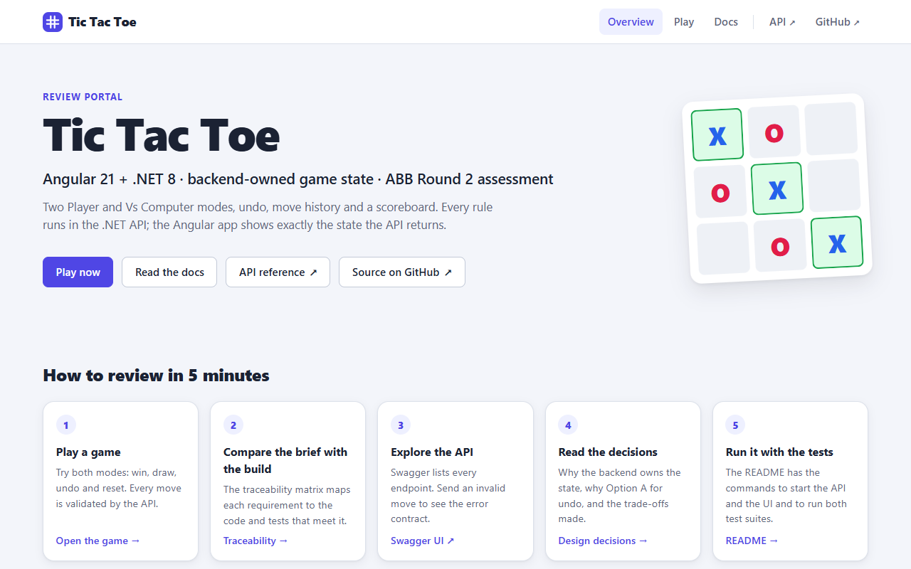
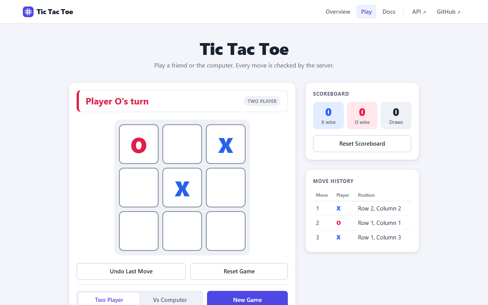
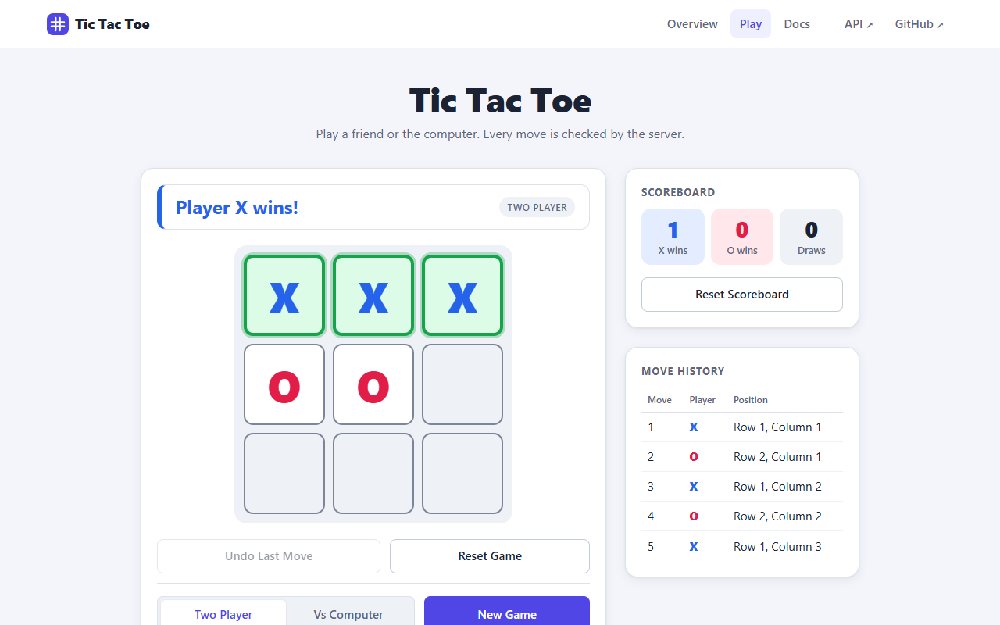
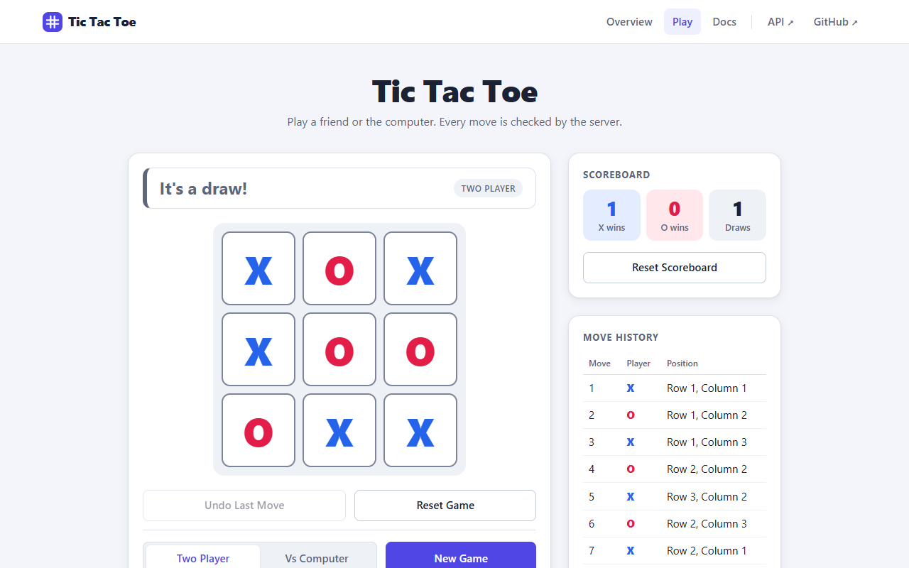
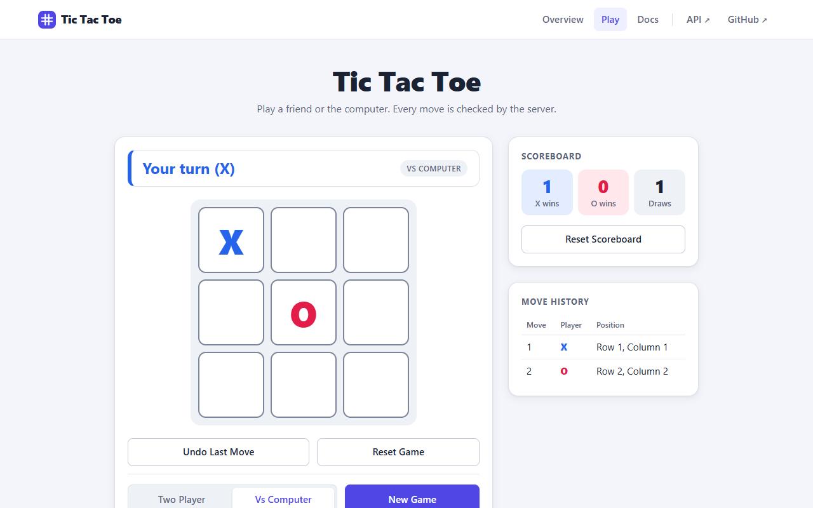
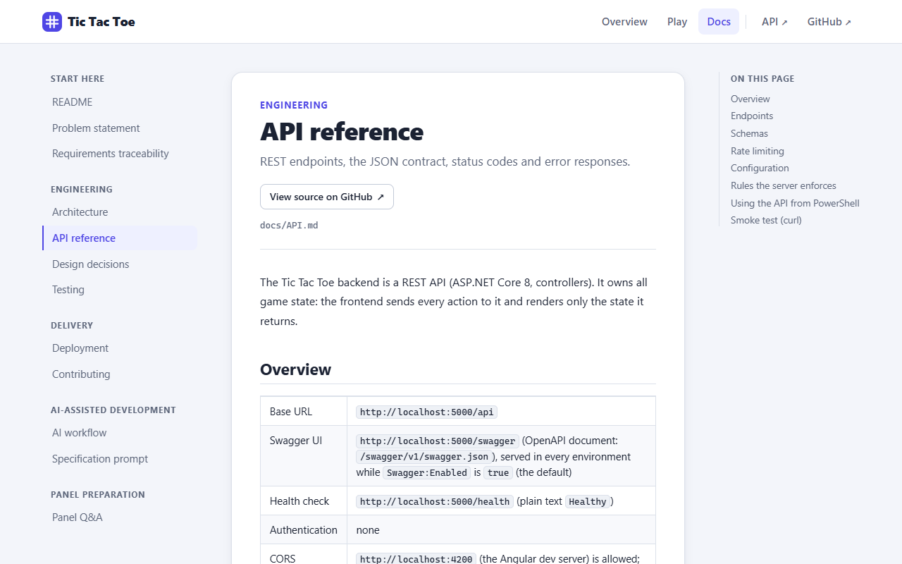
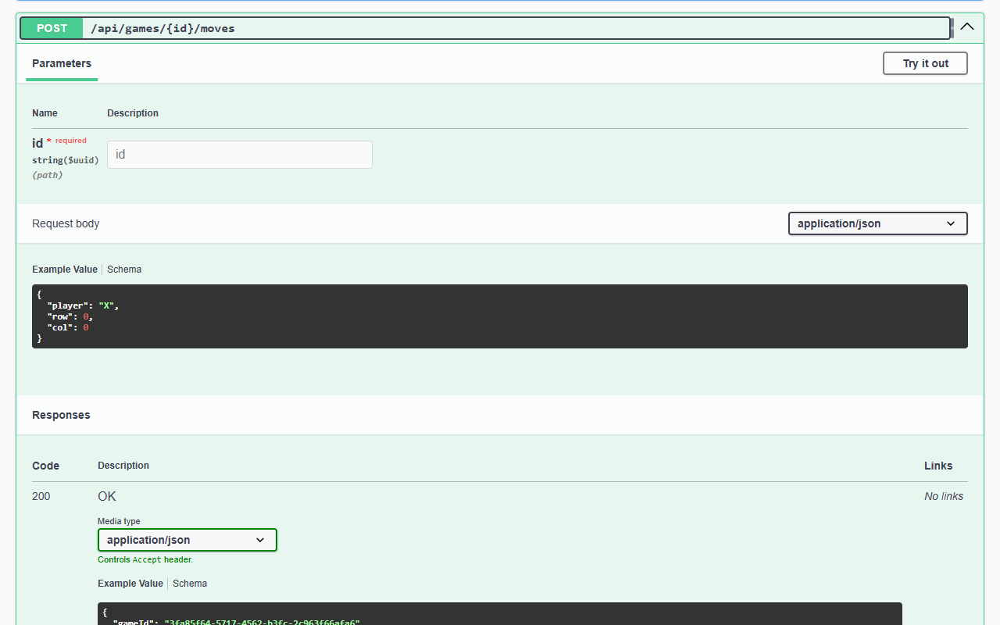

# Tic Tac Toe: Angular 21 + .NET 8

A browser-based Tic Tac Toe game built for the ABB Senior Software Engineer assessment (Round 2). The ASP.NET Core 8 Web API owns every rule and all game state: moves, turns, win and draw detection, undo, the computer opponent and the scoreboard. The Angular 21 app sends each action to the API and renders exactly the state the API returns. The same app is also a review portal that renders this repository's documentation.

**[Live demo](https://tictactoe-abb.vercel.app)** · [Docs](https://tictactoe-abb.vercel.app/docs) · [API (Swagger)](https://tictactoe-abb.vercel.app/swagger) · [Problem statement](docs/PROBLEM_STATEMENT.md)

> The API runs on a free host that sleeps when idle, so the first request after a quiet period can take about a minute.

**Quick start** (Windows PowerShell, two terminals, from the repository root): `cd backend; dotnet run --project TicTacToe.Api` · `cd frontend; npm ci; npm start` → open <http://localhost:4200>

## Project overview

The brief asks for a Tic Tac Toe game with an Angular frontend and a .NET backend: move history, undo by game mode, a backend-owned scoreboard and a basic computer opponent ([full brief](docs/PROBLEM_STATEMENT.md)).

```text
Angular 21 SPA (http://localhost:4200)               ASP.NET Core 8 Web API (http://localhost:5000)
  Pages: Overview · Play · Docs                        GamesController, ScoreboardController
  GameStore: signals, UI state only   -- REST/JSON --> GameService: one lock per game
  GameApiService: HttpClient          <-- GameState -- TicTacToe.Core: GameSession, GameEngine,
                                                         ComputerPlayer, Scoreboard
                                                       InMemoryGameRepository (ConcurrentDictionary)
```

- **`backend/TicTacToe.Core`**: the game rules in plain C#, with no ASP.NET dependency, so every rule is unit-tested without HTTP.
- **`backend/TicTacToe.Api`**: translates HTTP to Core calls, keeps games in memory and returns the full game state after every action.
- **`frontend/`**: a standalone, zoneless Angular app that holds only UI state and never re-implements a rule.

## Tech stack

| Area | Technology |
|---|---|
| Frontend | Angular 21.2 (standalone components, signals, zoneless, `OnPush`), TypeScript 5.9 (strict), RxJS 7.8, marked 18 (docs rendering), plain CSS |
| Backend | .NET 8, ASP.NET Core Web API with controllers, Swagger / OpenAPI (Swashbuckle 6.6), RFC 7807 problem details, built-in rate limiter and health checks |
| Storage | In memory: `ConcurrentDictionary` behind `IGameRepository`, scoreboard behind `IScoreboardService` |
| Tests | Backend: xUnit 2.9, `Microsoft.AspNetCore.Mvc.Testing`, `FakeTimeProvider`. Frontend: Vitest 4 + jsdom via the Angular CLI, `HttpTestingController` |
| Quality gates | `TreatWarningsAsErrors`, nullable reference types, Central Package Management, `.editorconfig`, Prettier |
| Delivery | GitHub Actions CI, Dependabot, Docker (API image), Vercel (web), Render (API) |

## Features implemented

**Required by the brief**

- [x] **3×3 board.** Empty cells are buttons; a played cell shows X or O and stays locked (the API rejects the move as well).
- [x] **Player turns.** X always starts; the status shows whose turn it is; a rejected move never changes the turn.
- [x] **Win detection** on every row, column and diagonal: the winner is shown, the winning cells are highlighted and the board locks.
- [x] **Draw detection.** A full board with no line shows "It's a draw!" and locks the board.
- [x] **Reset Game** clears the board, history and result and gives the turn back to X; the scoreboard is unchanged.
- [x] **Move history** with Move, Player and Position ("Row 1, Column 1"), updated after every valid move.
- [x] **Undo Last Move** by mode: Two Player removes one move, Vs Computer removes your move and the computer's reply. Disabled when there is nothing to undo and after the game ends (Option A).
- [x] **Scoreboard** of X wins, O wins and draws, kept by the backend; each finished game counts exactly once; separate **Reset Scoreboard**.
- [x] **Computer mode.** The human is X, the computer is O and replies in the same request, following the brief's priority: win → block → center → corner → any cell.
- [x] **Backend validation** of every move (outside the board, occupied cell, game over, wrong player) with a 400 and a clear message.
- [x] **Error display** in a non-blocking toast that stays until dismissed or replaced by the next action.

**Beyond the brief**

- **Review portal**: an Overview page with a review guide, the game at `/play`, and every document rendered at `/docs` with a sidebar, an "On this page" list and links to the source on GitHub.
- **Robust UI states**: no double submits while a request is in flight; a refresh resumes the current game; a game the server no longer has is replaced by a new one in the same mode, with a toast explaining why.
- **Accessibility basics**: real buttons with labels such as "Row 1, Column 1, empty", status announced through `aria-live`, visible focus rings, reduced-motion support.
- **Hardening for a public demo**: `GET /health`, rate limiting (300 requests per minute per client, of which 30 may create games), a 4 KB request-body limit, idle-game cleanup after 2 hours, settings validated at startup.

## Prerequisites

| Tool | Version | Check |
|---|---|---|
| .NET SDK | **8.0.x** (tested with 8.0.426). [`backend/global.json`](backend/global.json) pins the 8.0 line, so a .NET 9 or 10 SDK alone is not enough. | `dotnet --version` |
| Node.js | **22.12+ or 24.x LTS** (tested with 24.14.0); Angular 21 requires `^20.19 \|\| ^22.12 \|\| >=24` | `node --version` |
| npm | **10+** (tested with 11.9.0) | `npm --version` |
| Angular CLI | 21.2, **optional**: the npm scripts use the project's local CLI | `npx ng version` |
| Git | any recent version | `git --version` |

Get the code with `git clone https://github.com/intellectwithvivek/ABB.git`, then `cd ABB`. All commands are for **Windows PowerShell 5.1** and start from the repository root; use `curl.exe`, because `curl` is an alias in PowerShell 5.1.

## How to run the backend locally

```powershell
cd backend
dotnet run --project TicTacToe.Api
```

Wait for `Now listening on: http://localhost:5000` (the first run restores NuGet packages); stop with `Ctrl+C`. The API is at <http://localhost:5000/api>, Swagger UI at <http://localhost:5000/swagger> and the health check at <http://localhost:5000/health>. Check it from a second terminal with `curl.exe http://localhost:5000/health` (returns `Healthy`); [`TicTacToe.Api.http`](backend/TicTacToe.Api/TicTacToe.Api.http) has a sample request for every endpoint.

| Problem | Fix |
|---|---|
| `dotnet` is not recognized | The SDK is not on `PATH`. In the same window run `$env:PATH = "C:\Program Files\dotnet;" + $env:PATH`. |
| `address already in use` on port 5000 | An earlier run is still listening. Stop it with the command below. |
| `0x800711C7` "An Application Control policy has blocked this file" | Windows Smart App Control blocked a freshly built DLL. Run `dotnet build --no-incremental` and try again. Do not turn the protection off. |

```powershell
Get-NetTCPConnection -LocalPort 5000 -State Listen | ForEach-Object { Stop-Process -Id $_.OwningProcess -Force }
```

## How to run the frontend locally

In a second terminal, from the repository root:

```powershell
cd frontend
npm ci
npm start
```

Open <http://localhost:4200>: Overview at `/`, the game at `/play`, documentation at `/docs`. `npm start` first copies `README.md` and `docs/` into the app (`scripts/copy-docs.mjs`), then runs `ng serve`. The UI calls the API at `http://localhost:5000/api` ([`environment.ts`](frontend/src/environments/environment.ts)), so start the backend first. `npm run build` writes a production build to `frontend/dist/tictactoe-web/browser`.

If PowerShell reports that `npm.ps1` cannot be loaded, use `npm.cmd ci` and `npm.cmd start`. If port 4200 is taken, run `npm start -- --port 4300` and start the API with `$env:Cors__AllowedOrigins__0 = "http://localhost:4300"; dotnet run --project TicTacToe.Api`.

## API endpoint summary

The full contract, with schemas, every error and a recorded smoke test, is in **[docs/API.md](docs/API.md)**. Live: <https://tictactoe-abb.vercel.app/swagger>.

| Method | Endpoint | Purpose | Success | Errors |
|---|---|---|---|---|
| POST | `/api/games` | Create a game. Body: `{ "mode": "TwoPlayer" \| "VsComputer" }` | 201 GameState + `Location` | 400 |
| GET | `/api/games/{id}` | Get the current game state | 200 GameState | 404 |
| POST | `/api/games/{id}/moves` | Submit a move. Body: `{ "player": "X", "row": 0, "col": 2 }`. In Vs Computer mode the response includes the computer's reply. | 200 GameState | 400, 404 |
| POST | `/api/games/{id}/undo` | Undo the last move (Two Player) or the last pair (Vs Computer) | 200 GameState | 400, 404 |
| POST | `/api/games/{id}/reset` | Reset the game: same id and mode, scoreboard unchanged | 200 GameState | 404 |
| GET | `/api/scoreboard` | Get the scoreboard | 200 Scoreboard | — |
| POST | `/api/scoreboard/reset` | Reset all counters to zero | 200 Scoreboard | — |
| GET | `/health` | Liveness check for the hosting platform | 200 `Healthy` | — |

Every game endpoint returns the full `GameState` (`gameId`, `mode`, `board`, `currentPlayer`, `status`, `winner`, `winningCells`, `moveHistory`, `canUndo`, `scoreboard`), so the frontend never computes a rule. Errors are `application/problem+json`, for example `{ "title": "Invalid move", "status": 400, "detail": "Cell (row 0, col 0) is already taken by X." }`. Rows and columns are 0-based in the API and 1-based in the UI. A client above the rate limit gets a 429 (`/health` is exempt).

## How to run tests

```powershell
cd backend
dotnet test
cd ..\frontend
npm run test:ci
```

- **Backend (xUnit): 130 tests passed, 0 failed.** 70 Core unit tests (board, engine rules, sessions and undo, computer opponent, scoreboard) and 60 API tests (application service, idle-game cleanup, error handling, configuration, rate limiting, and in-memory HTTP integration tests with `WebApplicationFactory`).
- **Frontend (Vitest): 26 test files, 170 tests passed**, covering the game components, the signal store, `GameApiService`, error mapping, routing and the docs portal. `npm test` runs the same suite in watch mode; `npm run format:check` checks formatting.

| Brief asks to test | Test (in `backend/TicTacToe.Tests/Core/`) |
|---|---|
| Valid move, turn switching | `GameEngineTests.ApplyMove_ValidMove_PlacesMarkAndRecordsMove`, `ApplyMove_ValidMove_PassesTurnToOtherPlayer` |
| Invalid move | `GameEngineTests.ApplyMove_OutsideBoard_ThrowsAndKeepsTurn`, `ApplyMove_OccupiedCell_ThrowsAndKeepsTurn`, `ApplyMove_WrongPlayer_ThrowsAndKeepsTurn` |
| Row, column, diagonal win | `GameEngineTests.ApplyMove_CompletesRow_WinsWithRowCells`, `ApplyMove_CompletesColumn_WinsWithColumnCells`, `ApplyMove_CompletesMainDiagonal_WinsWithDiagonalCells`, `ApplyMove_CompletesAntiDiagonal_WinsWithDiagonalCells` |
| Draw | `GameEngineTests.ApplyMove_FillsBoardWithoutLine_EndsInDraw` |
| Reset; undo in both modes | `GameSessionTests.Reset_AfterWin_ClearsGameStartsWithXAndKeepsScoreboard`, `Undo_TwoPlayerMode_RemovesLastMoveAndRestoresTurn`, `GameSessionVsComputerTests.Undo_AfterHumanAndComputerMoved_RemovesBothAndRestoresXTurn` |
| Scoreboard update | `GameSessionTests.PlayMove_GameWon_RecordsWinExactlyOnce`, `PlayMove_GameDrawn_RecordsDrawExactlyOnce` |
| Computer move selection | `ComputerPlayerTests`: one test per priority rule, "win beats block", and the full-board guard |
| No move after completion | `GameEngineTests.ApplyMove_AfterGameWon_ThrowsGameOver`, `ApplyMove_AfterDraw_ThrowsGameOver`, `GameSessionVsComputerTests.PlayMove_HumanCompletesLine_ComputerDoesNotMove` |

[docs/TESTING.md](docs/TESTING.md) describes both suites; [docs/TRACEABILITY.md](docs/TRACEABILITY.md) maps every requirement to its code and tests.

## AI tools and prompt summary

- **Tool:** Claude Code (Anthropic) in VS Code on Windows 11, model Claude Opus 5.5.
- **Specification first:** I rewrote the brief as an executable specification (fixed stack, exact API and state contract, decided clarifications, named tests, build phases, quality bar), recorded verbatim in [docs/SPEC_PROMPT.md](docs/SPEC_PROMPT.md).
- **Follow-up prompts:** publish under my own identity; add an enterprise structure, a review portal and free hosting; deploy; finish end to end; review and polish.
- **Reviewed most carefully:** the computer's priority order, the Vs Computer undo pair, counting each result exactly once, the per-game lock and the error mapping.

The prompts, what was generated, what I changed and the trade-offs are in **[docs/AI_WORKFLOW.md](docs/AI_WORKFLOW.md)**.

## Design decisions

- **Rules in a pure Core library.** `GameEngine` holds the rules of Tic Tac Toe; `GameSession` holds the product policy (modes, computer reply, Option A undo, scoring once).
- **Derived, not stored, state.** The current player comes from the move count and the outcome is recomputed after every change, so undo cannot leave stale state.
- **Backend as the single source of truth.** Every endpoint returns the full `GameState`, including `canUndo`; the Angular store keeps the last snapshot plus UI flags.
- **The computer moves inside `POST /moves`**: one request, one consistent state, nothing for the client to orchestrate.
- **Thread safety.** Singleton repository and scoreboard, plus one lock per game, so a double click can never apply two moves.
- **Errors as RFC 7807 problem details** with one human-readable message per rule; the UI shows `detail` as is.
- **One source of truth for docs.** The portal renders the same Markdown files that GitHub shows.

Details and alternatives: **[docs/DECISIONS.md](docs/DECISIONS.md)**; structure: **[docs/ARCHITECTURE.md](docs/ARCHITECTURE.md)**.

## Clarifications and assumptions

- **Option A is implemented: Undo is disabled once a game is Won or Drawn, and the scoreboard is final for that game.** `canUndo` is `false` and the API rejects such an undo with a 400. Undo is also disabled when there are no moves.
- **The computer's move happens inside `POST /api/games/{id}/moves`**, server-side, and the response already includes it. If the human's move ends the game, the computer does not move.
- **In Vs Computer mode the human is X and the computer is O.** One undo removes the computer's reply and your previous move.
- **Reset keeps the game id and mode**, clears board, history and result, and leaves the scoreboard untouched. **New Game** creates a new id in the selected mode.
- **The scoreboard is global per server process** ("session-level" = server lifetime): one scoreboard shared by every game and browser.
- **Storage is in memory**, as the brief allows: games and the scoreboard live in the API process, behind `IGameRepository` and `IScoreboardService`.
- A win is checked before a draw, so a ninth move that completes a line is a win.

## Known limitations

- **In-memory state.** A restart or redeploy clears all games and the scoreboard; games idle for 2 hours are removed.
- **The free API host sleeps** after 15 idle minutes; the first request then takes about a minute, and the earlier state is gone.
- **Single instance only.** State lives in one process, so the API cannot scale out without a shared store.
- **One public scoreboard.** On the live demo every visitor shares (and can reset) the same totals; there is no authentication.
- **A deliberately basic computer.** It follows the brief's priority list without look-ahead, so a fork beats it (as X: Row 1 Col 1, Row 3 Col 3, Row 3 Col 1, then Row 2 Col 1).
- **No real-time sync** between two tabs showing the same game, and **no browser end-to-end tests in CI**.

## Future improvements

- Persist games and scores in Redis or SQL behind `IGameRepository` and `IScoreboardService`, enabling multiple instances or serverless hosting.
- Add players and authentication, plus real-time multiplayer with SignalR.
- Offer a minimax opponent as a selectable difficulty, keeping the brief's rule-based mode as "Easy".
- Add Playwright end-to-end tests to CI, and Docker Compose for a one-command local stack.
- Add observability: OpenTelemetry traces and metrics, structured logs.

## Screenshots

Captured from the running app at 1280×800. To refresh one, run the app locally (Quick start), reproduce the state and save the PNG under the same name in `docs/screenshots/`.

**1. Overview page**


**2. Two Player game in progress**


**3. X wins, winning cells highlighted, Undo disabled**


**4. Draw**


**5. Vs Computer after Undo**


**6. Documentation portal**


**7. Swagger UI**


## Documentation index

Every document is also rendered in the portal at [tictactoe-abb.vercel.app/docs](https://tictactoe-abb.vercel.app/docs).

| Document | What it covers |
|---|---|
| [Problem statement](docs/PROBLEM_STATEMENT.md) | The official brief (original: [Round-2-Problem-Statement.docx](docs/assets/Round-2-Problem-Statement.docx)) |
| [Requirements traceability](docs/TRACEABILITY.md) | Every requirement mapped to its code and tests |
| [Architecture](docs/ARCHITECTURE.md) | How the Angular app, the API and `TicTacToe.Core` fit together |
| [API reference](docs/API.md) | Endpoints, JSON contract, errors, configuration, smoke test |
| [Design decisions](docs/DECISIONS.md) | Decisions, trade-offs and alternatives |
| [Testing](docs/TESTING.md) | What each suite covers and how to run it |
| [Design Q&A](docs/PANEL_QA.md) | Reviewer questions answered from the code |
| [Deployment](docs/DEPLOYMENT.md) | Vercel + Render setup, configuration, operations |
| [Contributing](docs/CONTRIBUTING.md) | Branches, commits, quality gates, conventions |
| [AI workflow](docs/AI_WORKFLOW.md) | How AI tools were used and what was reviewed |
| [Specification prompt](docs/SPEC_PROMPT.md) | The specification I wrote, verbatim |

## Repository structure

```text
ABB/
├── backend/                 TicTacToe.sln, global.json, nuget.config, Directory.*.props, Dockerfile
│   ├── TicTacToe.Core/      game rules, no ASP.NET: Domain/ Engine/ Opponents/ Sessions/ Scoring/
│   ├── TicTacToe.Api/       REST API: Controllers/ Application/ Contracts/ Mapping/ Infrastructure/ ...
│   └── TicTacToe.Tests/     xUnit: Core/ and Api/ (mirroring the source), TestSupport/
├── frontend/                Angular 21 workspace; scripts/copy-docs.mjs
│   └── src/app/             core/ (config, HTTP errors, layout, routing), shared/ui/, features/ (home, game, docs)
├── docs/                    documentation (rendered by the portal), screenshots/, assets/
├── .github/                 CI workflow, Dependabot, pull request template
├── vercel.json              web: builds frontend/, proxies /api and /swagger to the API
└── render.yaml              API: Render Blueprint for the Docker web service
```

## Deployment

Vercel builds the Angular app from this repository and proxies `/api` and `/swagger` to the API, which Render runs as a Docker web service from `backend/Dockerfile`. The browser stays on one origin, so production needs no CORS, and Render deploys a commit only after CI passes. Steps, configuration and troubleshooting: **[docs/DEPLOYMENT.md](docs/DEPLOYMENT.md)**.
